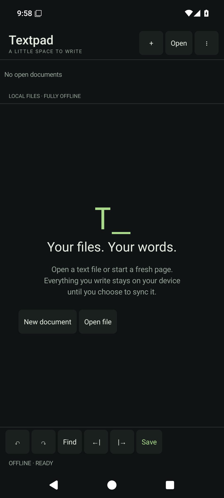
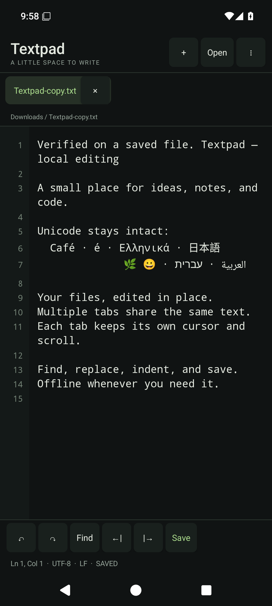

# Textpad for Android

A native, dark-by-default text editor for **Android 16 / API 36 and later**. The Android application is implemented first; the Debian sync service is the next component. No service has been deployed or certificates generated on your server.

 

## Build and install

Open this directory in Android Studio, or use a JDK 17/21 and Android SDK platform 36 with build tools 36.0.0:

```sh
export JAVA_HOME=/path/to/jdk
export ANDROID_HOME=/path/to/android-sdk
./scripts/build.sh
adb install -r app/build/outputs/apk/debug/app-debug.apk
```

The build script also finds the isolated toolchain installed for this workspace at `~/.cache/android-textpad/`. The Gradle wrapper pins Gradle 8.13 and Android Gradle Plugin 8.13.2. The debug APK is signed automatically. Keep the same debug keystore when building subsequent updates.

## Editor

- New, Open, Save, Save As, Save to existing file, recent files, read-only documents, and Android's standard file picker. The original selected file is edited in place.
- Multiple tabs, including multiple views of one file. Text and undo history are shared; selections and scrolling belong to each tab. Long-press a tab for its file location and details.
- Unsaved dots and Save/Discard/Cancel when closing a modified tab. No Quit action, persistent tabs, drafts, or crash recovery. Rotation preserves the live editing session. Process termination loses unsaved edits.
- Undo/redo, literal find/replace with case matching, replace all, selection/clipboard, indentation, word wrap, line-number toggles, font families and sizes.
- UTF-8 by default, ASCII, UTF-16 LE/BE, emoji, combining characters, RTL text. Existing BOMs and LF/CRLF/CR terminators, including mixed files, are preserved. Use **Open with encoding** for ambiguous BOM-less UTF-16. Binary/control data and invalid encodings are rejected rather than replaced silently.
- Files up to 10 MiB. Loads and disk operations run on an I/O executor. The editor uses Android's native text layout; large-file speed still depends on the device and wrapping.
- Optional foreground autosave: off by default; 30 seconds or 1, 2, 3, 5, 8, 10, 15 minutes. It saves existing writable documents; new files still need Save As. It does not keep the app executing in the background.

Shortcuts: Ctrl+N/O/S, Ctrl+Shift+S, Ctrl+F, Ctrl+Z, Ctrl+Shift+Z or Ctrl+Y, Ctrl+W, Tab/Shift+Tab for indentation. Android provides normal selection and clipboard shortcuts.

The standard **Save As** picker creates a new document and may suffix an existing filename. Use **Save to existing file** to select and confirm overwriting a particular existing document.

## Save protection and backups

Before an overwrite, the application re-reads the destination and compares its SHA-256 fingerprint with the opened/last-saved version. If it changed, you must confirm the overwrite. Existing contents are backed up before any truncation; the resulting contents are verified after writing. On failure, the app attempts and verifies rollback, retains your open edits, and reports the result.

Android document providers do not expose a universal atomic compare-and-swap operation. Another app can still race the final check/write. If a provider or storage failure also prevents rollback, recover the old bytes from **More → Backups**. There is no claim of atomic replacement across all providers.

Backups live in the app-private `files/backups/` directory, remain until manually deleted, and are removed when the app is uninstalled. Open a backup as a new document, then save it to a chosen location. Cloud/device backups of app data are excluded.

## Sync client

**More → Sync → Actions** contains settings, opt-in file linking, server browsing, manual sync, and a list of opted-in local files. Set an HTTPS endpoint and API token after the server is available. The initial endpoint is `https://git23069.hopto.org:8443`; the port is configurable. The token is encrypted with an Android Keystore key. App configuration trusts user-installed CA certificates for `git23069.hopto.org` while retaining normal TLS hostname verification.

Only saved local files that are individually opted in participate. Links survive process restarts independently of tabs. Same-name candidates are ranked by bounded content similarity and require confirmation; thereafter a stable document ID links copies across different paths. First linking lets you choose the local or server version. Server browsing downloads to a local file through Save As before opening it for editing.

Sync runs on save, returning to the app, and manual request. Dirty buffers defer synchronization. Remote writes back up the displaced local file and briefly suspend editing during replacement. Offline edits upload with last-write-wins in server acceptance order. Stable request IDs allow retrying an interrupted upload without changing its acceptance order. Local deletion does not delete the server copy; inaccessible files are reported. Server revision browsing/restoration is included in the client.

The server must implement [the API contract](docs/sync-api.md), including revision retention and idempotent upload receipts. The client has been tested against a controlled in-memory API; your Debian server and its CA-signed HTTPS endpoint have not yet been integrated.

## Validation

```sh
./scripts/build.sh
./scripts/build.sh :app:connectedDebugAndroidTest  # connected Android 16+ device/emulator
```

Core JVM tests cover strict encoding, byte-exact Unicode/BOM/newline round trips, 10 MiB limits, randomized edit/undo/line-index behavior, saved-state tracking, and overwrite/rollback failure paths. Android instrumentation covers native editor operations, actual file-descriptor reads/writes through a test content provider, duplicate tabs, activity recreation, read-only documents, external modification checks, 10 MiB editing/saving, and sync policy with an injected API.

The original `requirements.txt`, `questions.txt`, and `questions2.txt` remain the source of the agreed scope; [the consolidated requirements](docs/requirements.md) record implementation decisions.

Verified on an Android 16 emulator: **26 JVM tests and 9 instrumentation tests pass**, the debug APK signature verifies, and Android lint completes without errors. Manual checks using Android's real Downloads picker also verified byte-exact unchanged saves, Unicode editing/saving, Save As, backup revision opening, deliberate loss of unsaved edits after process termination, and reopening recent files using persisted permissions.
